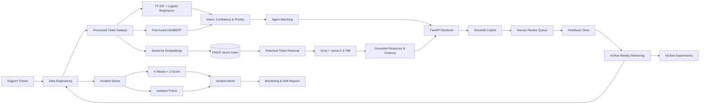

# Smart Support Ticket Triage & Copilot

**An end-to-end, human-centered MLOps platform that classifies support tickets, recommends grounded answers, detects incident spikes, and assigns the best available agent.**

[](https://www.python.org/)
[](https://pytorch.org/)
[](https://huggingface.co/)
[](https://fastapi.tiangolo.com/)
[](https://streamlit.io/)
[](https://dvc.org/)
[](https://mlflow.org/)

---

## 📖 Project Overview

Support operations generate a large, continuously changing stream of customer requests. **Smart Support Ticket Triage & Copilot** combines four AI components to reduce manual effort while keeping agents in control:

- Classifies customer intent and routes low-confidence predictions to human review.
- Retrieves relevant historical tickets and generates grounded response suggestions with source citations.
- Detects anomalous increases in specific support intents to surface emerging incidents early.
- Matches each ticket to an available agent using skill and workload signals.

The repository is designed as a reproducible portfolio and MLOps project: data artifacts are versioned with DVC, experiments are tracked with MLflow, production-facing services are exposed through FastAPI, and agents interact through a Streamlit interface.

## 🏗️ System Architecture



### Component Flow

1. **Data ingestion:** Public customer-support intent data is merged with synthetic telecom metadata such as priority, timestamps, workloads, and injected incident spikes.
2. **Classification:** DistilBERT predicts ticket intent. Predictions below a confidence threshold of `0.7` are sent to manual review.
3. **Retrieval-augmented generation:** FAISS retrieves similar historical tickets, and Groq with Llama-3.3-70B generates an answer grounded in the retrieved context.
4. **Anomaly detection:** Hourly intent volume is analyzed to identify abnormal spikes.
5. **Agent assignment:** A weighted score selects the best agent: 70% skill match and 30% workload capacity.
6. **Operations:** The API powers the Streamlit interface, while DVC, MLflow, EvidentlyAI, Plotly, and Airflow support reproducibility and monitoring.

## 🚀 Key Features

### 1. Ticket Classification

- TF-IDF + Logistic Regression baseline.
- Fine-tuned DistilBERT classifier for intent recognition.
- Confidence-aware routing with the `< 0.7` human-review threshold.
- Sentiment and priority signals for customer-need prioritization.
- MLflow tracking for classification metrics and experiment runs.

### 2. Retrieval-Augmented Generation

- FAISS vector database for semantic retrieval of historical tickets.
- Top-k historical ticket context for grounded answer generation.
- Groq API integration with Llama-3.3-70B.
- Source ticket IDs displayed with every suggested response.
- Retrieval distance monitoring and unanchored-response detection.
- Suggested FAQ creation when a repeated question has no strong retrieval match.

### 3. Incident Anomaly Detection

- Hourly ticket volume aggregation by intent.
- K-Means + Z-Score evaluation baseline.
- Isolation Forest comparison.
- Detection delay, precision, recall, and false-positive analysis.
- Incident alerts for emerging support trends.

### 4. Agent Assignment

- Weighted routing score:

  ```text
  final_score = (skill_match × 0.70) + (available_capacity × 0.30)
  ```

- Skill match is binary: `1.0` for a matching skill and `0.0` otherwise.
- Capacity is normalized against each agent's maximum workload.
- Recommended agent, match score, and current workload are returned through the API.

### Human-in-the-Loop Interface

- Unified Streamlit review queue.
- Low-confidence ticket review.
- Suggested response and cited source inspection.
- Repeated question and knowledge-gap identification.
- Agent feedback collection for future retraining.
- Plotly operational dashboard and EvidentlyAI drift reports.

## 🛠️ Tech Stack

| Area | Technology |
|---|---|
| Language | Python |
| Machine Learning | PyTorch, Scikit-Learn |
| NLP / Transformers | HuggingFace Transformers, DistilBERT |
| Vector Search | FAISS |
| Generative AI | Groq API, Llama-3.3-70B |
| Backend | FastAPI, Uvicorn, Pydantic |
| Frontend | Streamlit |
| Experiment Tracking | MLflow |
| Data / Pipeline Versioning | DVC |
| Monitoring | EvidentlyAI, Plotly |
| Orchestration | Apache Airflow |

## 📂 Project Structure

```text
ticket-triage-copilot/
├── app.py                         # Streamlit human-in-the-loop interface
├── dvc.yaml                       # Reproducible DVC stages
├── dvc.lock                       # Resolved DVC pipeline dependencies
├── mlflow.db                      # Local MLflow tracking database
├── requirements.txt
├── airflow/
│   ├── hello.py
│   └── dags/
│       └── retrain_pipeline.py    # Weekly retraining workflow
├── data/
│   ├── raw/                       # Source data
│   ├── synthetic/                 # Synthetic telecom metadata
│   ├── hf_cache/                  # HuggingFace dataset cache
│   └── processed/
│       ├── tickets.parquet
│       ├── incidents.csv
│       ├── tickets_faiss.index
│       └── faiss_metadata.pkl
├── models/
│   ├── baseline_logreg.pkl
│   ├── tfidf_vectorizer.pkl
│   ├── baseline_report.txt
│   └── distilbert/                # Fine-tuned model and tokenizer
├── notebooks/
├── reports/
│   ├── data_drift_report.html
│   └── grafana_dashboard.html
└── src/
    ├── data/
    │   ├── load.py
    │   └── merge.py
    ├── classification/
    │   ├── baseline.py
    │   └── distilbert.py
    ├── rag/
    │   ├── index.py
    │   ├── retrieve.py
    │   └── generate.py
    ├── anomaly/
    │   └── detect.py
    ├── api/
    │   ├── main.py
    │   └── agents_db.py
    └── monitoring/
        ├── drift.py
        └── dashboard.py
```

## ⚙️ How to Run the Project

### 1. Clone the Repository

```bash
git clone <your-repository-url>
cd ticket-triage-copilot
```

### 2. Create a Virtual Environment

**Windows (PowerShell):**

```powershell
python -m venv .venv
.\.venv\Scripts\Activate.ps1
```

**macOS / Linux:**

```bash
python -m venv .venv
source .venv/bin/activate
```

### 3. Install Dependencies

```bash
python -m pip install --upgrade pip
pip install -r requirements.txt
```

The requirements include the Groq client dependency needed by the RAG generator.

### 4. Configure the Groq API Key

Create a `.env` file in the repository root:

```dotenv
GROQ_API_KEY=your_groq_api_key
```

Keep the key out of source control.

### 5. Reproduce or Retrieve Versioned Data

Reproduce the DVC pipeline:

```bash
dvc repro
```

If the repository has a configured DVC remote and the artifacts are stored there instead, retrieve them with:

```bash
dvc pull
```

The DVC pipeline prepares the tickets and incident data, trains the baseline, builds the FAISS index, generates the drift report, and produces the dashboard.

### 6. Start the FastAPI Backend

```bash
uvicorn src.api.main:app --reload --host 127.0.0.1 --port 8000
```

Interactive API documentation:

- Swagger UI: <http://127.0.0.1:8000/docs>
- OpenAPI schema: <http://127.0.0.1:8000/openapi.json>

### 7. Start the Streamlit Interface

In a second terminal:

```bash
streamlit run app.py
```

Open <http://localhost:8501>.

### 8. Launch MLflow

In a separate terminal:

```bash
mlflow ui --backend-store-uri sqlite:///mlflow.db
```

Open <http://127.0.0.1:5000>.

### 9. Run the Anomaly Detection Stage

```bash
python -m src.anomaly.detect
```

The detected anomalies and evaluation metrics are logged to MLflow.

### 10. Start the Airflow DAG Scheduler

Configure the repository path in `airflow/dags/retrain_pipeline.py`, start the Airflow environment, and place the DAG folder on its DAG search path. The DAG `ticket_copilot_weekly_retraining` runs DVC reproduction, FAISS re-indexing, and drift-report generation on a weekly schedule.

## 📊 Results & Metrics

### Classification

| Model | F1-Macro | Summary |
|---|---:|---|
| TF-IDF + Logistic Regression | 99.39% | Strong baseline; 27 intent classes evaluated |
| Fine-tuned DistilBERT | **99.72%** | Selected model for production intent classification |

### Human-in-the-Loop Policy

| Confidence | Routing |
|---|---|
| ≥ 70% | Automated classification and agent recommendation |
| < 70% | Routed to the unified human review queue |

### RAG Service

| Metric | Observed / Reported Result |
|---|---:|
| Generation latency | ~1.4 seconds |
| P50 latency | 1.2 seconds |
| P90 latency | 1.4 seconds |
| P99 latency | 2.1 seconds |
| Retrieval grounding | Top-3 FAISS sources returned with each answer |
| Retrieval quality | Average FAISS L2 distance reported per request |
| Knowledge-gap handling | Unanchored response flagged above the retrieval-distance threshold |

The RAG service reports average retrieval distance and an unanchored-response flag. These metrics help operators identify weak matches and suggest new FAQ articles.

### Anomaly Detection

| Metric | Result |
|---|---:|
| Detection lead time | 6.6 hours |
| Hourly detection granularity | 1 hour |
| K-Means + Z-Score | Compared against synthetic incident ground truth |
| Isolation Forest | Compared using precision, recall, and detection delay |

MLflow stores the anomaly run metrics, and the dashboard exposes the resulting operational indicators.

## 👥 Authors

- Aziz Trabelsi
- Mohamed Aziz Mejri

---

**Academic Project:** 2025-2026
